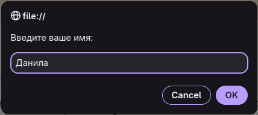
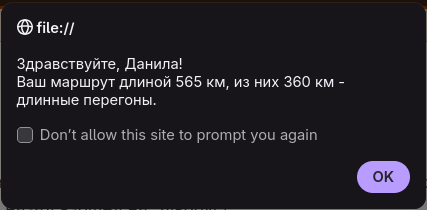
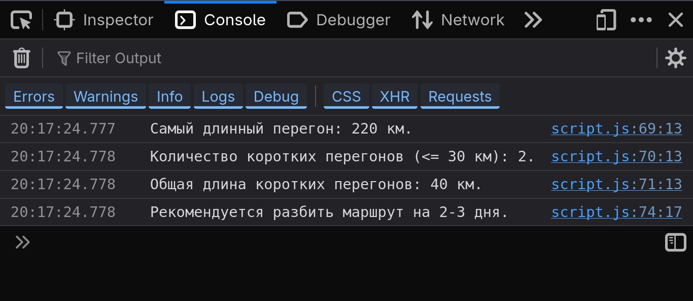

# Лабораторная работа №4 - Основы JavaScript

## Тема работы

Знакомство с синтаксисом языка программирования JavaScript, его базовыми конструкциями и логикой.

## Вариант 2 - "Путешественник"

Для примера анализа маршрута задаётся массив из 6 чисел, представляющих собой расстояния между городами в километрах.

Реализованы функции для поиска самого длинного перегона (`findMaxDistance`), фильтрации длинных перегонов длиной более `longRouteCriteria` (100) км (`filterLongRoutes`), вычисления общей длины маршрута (`calculateTotalDistance`) и подсчёта количества и общей длины коротких перегонов длиной не более `shortRouteCriteria` (30) км (`shortRoutesProcessing`).

При открытии страницы с помощью `prompt` запрашивается имя пользователя (также обрабатываются случаи невалидных значений вводимых данных), после чего с помощью `alert` выводится приветствие с общей длиной маршрута и уточнением, какая его часть состоит из длинных перегонов.

В консоль вместе с поясняющими сообщениями поочерёдно выводятся величина наидлиннейшего перегона, количество коротких перегонов и их (коротких перегонов) общая длина.

Дополнительно добавлена проверка общей длины маршрута: если она превышает `bigTotalDistanceCriteria` (500) км, в консоль выводится рекомендация разбить путешествие на 2-3 дня.

## Нововведения

В проект добавлена обработка данных с использованием следующих возможностей JavaScript:

* `const` и `let` для объявления переменных и констант;
* пользовательский ввод и вывод сообщений через `prompt` и `alert`;
* `console.log` для отладочного вывода в консоль;
* условная конструкция `if` для проверки выполнения тех или иных условий;
* цикл `for` для поиндексного перебора элементов массива;
* массивы для хранения расстояний между городами;
* метод `push` для добавления элемента в конец массива;
* функции для поиска максимума, фильтрации, вычисления суммы и др.;
* `return` для возврата результатов из функций;
* подключение внешнего JS-скрипта через ``, где атрибут `defer` запускает его (скрипт) сразу же после разбора браузером HTML-файла, но до его (HTML-файла) отрисовки.

## Использованные технологии

* HTML5;
* CSS3;
* CSS-переменные;
* псевдоклассы CSS;
* CSS Flexbox;
* CSS Grid;
* Медиазапросы (`@media`) для адаптивности на планшетах и мобильных устройствах;
* ARIA-атрибуты и `role="progressbar"` для доступности;
* JavaScript (ES6+);
* встроенные инструменты разработчика браузера (DevTools) для проверки работы скрипта;
* [W3C Validator](https://validator.w3.org) для проверки валидности HTML-кода;
* мобильные эмуляторы в DevTools для проверки адаптивности;
* VSCode (с расширениями);
* [ChatGPT](https://chatgpt.com);
* [DeepSeek](https://chat.deepseek.com).

## Примеры работы:

## Результат

В результате создан файл `script.js` для анализа маршрута путешественника в соответствии с ТЗ и требованиями моего варианта.

В работе продемонстрированы базовые конструкции JavaScript: переменные и константы, ввод и вывод данных, условные конструкции, циклы, работа с массивами, функции, - а также отладка с помощью встроенных инструментов разработчика браузера (DevTools) и соответствующей консоли.

Проект размещён в репозитории на GitHub.
